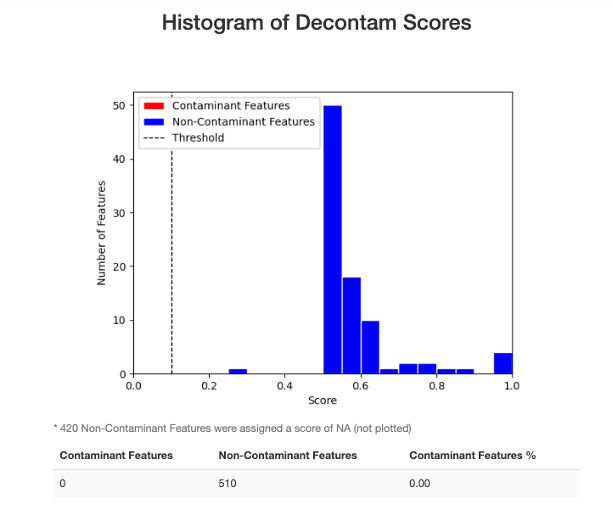

```{r setup, include=FALSE}
options(scipen=999)
knitr::opts_chunk$set(echo = TRUE, digits = 1)
knitr::opts_chunk$set(save_output = FALSE) # prevent outputs being over-written on knitting
library(tidyverse)
library(knitr)
library(qiime2R)

```

## 1. Import the data

Data is spread across plates 75, 76, 99, 100, 101, and 102. Plate 76 and 102 I combined into one plate for PCR and sequencing, as they were both partial extraction plates.


```
cd /Users/gc547/Dropbox/GitHub_copied/Fecal_metabarcoding/Middleton-Island_2023-2024_KD/18S
conda activate qiime2-amplicon-2024.10 

for K in 75 76-102 99 100 101; do
qiime tools import\
  --type 'SampleData[PairedEndSequencesWithQuality]'\
  --input-path /Volumes/Data_SS1/18S/Plate$K/reads/ \
  --input-format CasavaOneEightSingleLanePerSampleDirFmt\
  --output-path demux_Plate$K.qza
done

for K in 75 76-102 99 100 101; do
  qiime demux summarize \
    --i-data demux_Plate$K.qza \
    --o-visualization demux_Plate$K.qzv
done
``` 

## 2. Trim primers using cutadapt

The 18S sequences are:

F primer: GGTCTGTGATGCCCTTAGATG (21 bp)   
R primer: GGTGTGTACAAAGGGCAGGG (20 bp)


### Trim 3’ ends first
At the 3’ end of the read, the primer will have been read through after reading the 18S region. I need to be looking for the reverse complement of the reverse primer in read 1 (—p-adapter-f) and the reverse complement of the forward primer in R2 (—p-adapter-r).

F primer reverse complement: CATCTAAGGGCATCACAGACC   
R primer reverse complement: CCCTGCCCTTTGTACACACC
```
for K in 75 76-102 99 100 101; do
  qiime cutadapt trim-paired \
    --i-demultiplexed-sequences demux_Plate$K.qza \
    --p-adapter-f CCCTGCCCTTTGTACACACC \
    --p-adapter-r CATCTAAGGGCATCACAGACC \
    --o-trimmed-sequences trimd_Plate$K.qza \
    --verbose > cutadapt_out_Plate$K.txt
done
```

To see how much passed the filters:
```
for K in 75 76-102 99 100 101; do
  grep "Total written (filtered):" cutadapt_out_Plate$K.txt 
done
```
This is very consistent with 74 - 77% passing the filters, which is typical for this marker.

### Trim 5’ ends of reads
All R1 should begin with the forward primer: GGTCTGTGATGCCCTTAGATG (21 bases). All R2 should begin with the reverse primer: GGTGTGTACAAAGGGCAGGG (20 bases).

Trim these with the following commands:
```
for K in 75 76-102 99 100 101; do
  qiime cutadapt trim-paired \
    --i-demultiplexed-sequences trimd_Plate$K.qza \
    --p-front-f GGTCTGTGATGCCCTTAGATG \
    --p-front-r GGTGTGTACAAAGGGCAGGG \
    --o-trimmed-sequences trimd2_Plate$K.qza \
    --verbose > cutadapt_out2_Plate$K.txt
done
```
To see how much passed the filters:
```
for K in 75 76-102 99 100 101; do
  grep "Total written (filtered):" cutadapt_out2_Plate$K.txt 
done
```
89% passes here, also normal.

## 3. Denoise with Dada2

```
for K in 75 76-102 99 100 101; do
  qiime dada2 denoise-paired \
    --i-demultiplexed-seqs trimd2_Plate$K.qza \
    --p-trunc-len-f 150 \
    --p-trunc-len-r 150 \
    --p-trim-left-f 0 \
    --p-trim-left-r 0 \
    --p-min-overlap 50 \
    --p-n-threads 8 \
    --o-representative-sequences rep-seqs_Plate$K \
    --o-table table_Plate$K \
    --o-denoising-stats denoise_Plate$K
done
```

Create visualizations for the denoising stats.
```
for K in 75 76-102 99 100 101; do  
  qiime metadata tabulate\
    --m-input-file denoise_Plate$K.qza\
    --o-visualization denoise_Plate$K.qzv
done
```

## 4. Merge across plates

```
qiime feature-table merge \
  --i-tables table_Plate75.qza \
  --i-tables table_Plate76-102.qza \
  --i-tables table_Plate99.qza \
  --i-tables table_Plate100.qza \
  --i-tables table_Plate101.qza \
  --p-overlap-method sum \
  --o-merged-table merged-table.qza

qiime feature-table summarize \
    --i-table merged-table.qza \
    --m-sample-metadata-file metadata.txt \
    --o-visualization merged-table
    
qiime feature-table merge-seqs \
  --i-data rep-seqs_Plate75.qza \
  --i-data rep-seqs_Plate76-102.qza \
  --i-data rep-seqs_Plate99.qza \
  --i-data rep-seqs_Plate100.qza \
  --i-data rep-seqs_Plate101.qza \
  --o-merged-data merged_rep-seqs.qza

qiime feature-table tabulate-seqs \
  --i-data merged_rep-seqs.qza \
  --o-visualization merged_rep-seqs.qzv
```


## 5. Assign taxonomy using Naive Bayes classifier

I am going to use the same classifier that I had previously trained on the SILVA-132 database. The code I used for training it was:
```
# import database fasta file
qiime tools import \
  --input-path /Users/gemmaclucas/Dropbox/Diets_from_poop/2019_terns_puffins_fecal_data_analysis/18S/SILVA_132_QIIME_release/rep_set/rep_set_18S_only/99/silva_132_99_18S.fna \
  --output-path silva_132_99_18S_sequences.qza \
  --type 'FeatureData[Sequence]'

# extract region bounded by primers
qiime feature-classifier extract-reads \
  --i-sequences silva_132_99_18S_sequences.qza \
  --p-f-primer GGTCTGTGATGCCCTTAGATG \
  --p-r-primer GGTGTGTACAAAGGGCAGGG \
  --p-min-length 140  \
  --p-max-length 210  \
  --o-reads extracted-silva_132_99_18S_sequences.qza 

# import taxonomy
qiime tools import \
  --input-path /Users/gemmaclucas/Dropbox/Diets_from_poop/2019_terns_puffins_fecal_data_analysis/18S/SILVA_132_QIIME_release/taxonomy/18S_only/99/majority_taxonomy_7_levels.txt \
  --input-format HeaderlessTSVTaxonomyFormat \
  --type 'FeatureData[Taxonomy]' \
  --output-path silva_132_99_18S_taxonomy.qza

# train classifier  
qiime feature-classifier fit-classifier-naive-bayes \
  --i-reference-reads extracted-silva_132_99_18S_sequences.qza \
  --i-reference-taxonomy silva_132_99_18S_taxonomy.qza \
  --o-classifier classifier.qza
```

Run the classifier on these samples:
```
qiime feature-classifier classify-sklearn \
  --i-classifier classifier.qza \
  --i-reads merged_rep-seqs.qza \
  --o-classification sklearn_taxonomy.qza
  
qiime taxa barplot\
   --i-table merged-table.qza \
   --i-taxonomy sklearn_taxonomy.qza \
   --m-metadata-file metadata.txt \
   --o-visualization barplot_before_filtering.qzv
```
The blanks seems to mostly have fungal DNA in them, so that we can easily filter out. Lots of fish DNA in the samples :)

## 6. Filter out non-prey sequences

First just filter down to metazoans.
```
qiime taxa filter-table \
  --i-table merged-table.qza \
  --i-taxonomy sklearn_taxonomy.qza \
  --p-include Metazoa \
  --o-filtered-table merged-table_onlymetazoa.qza
  
qiime taxa barplot\
      --i-table merged-table_onlymetazoa.qza\
      --i-taxonomy sklearn_taxonomy.qza\
      --m-metadata-file metadata.txt\
      --o-visualization barplot_sklearn-taxa_onlymetazoa

```

Need to filter for just prey using level 6 of the assignments. This is what we decided to keep:
```
qiime taxa filter-table \
  --i-table merged-table_onlymetazoa.qza \
  --i-taxonomy sklearn_taxonomy.qza \
  --p-include Teleostei,Batoidea,Scyphozoa,Semaeostomeae,Tentaculata,Hydroidolina,Phyllodocida,Calanoida,Teuthida,Eumalacostraca,Pedunculata \
  --o-filtered-table merged-table_onlyprey.qza
  
qiime taxa barplot\
      --i-table merged-table_onlyprey.qza \
      --i-taxonomy sklearn_taxonomy.qza\
      --m-metadata-file metadata.txt\
      --o-visualization barplot_onlyprey 
```

## 7. Read depth comparison

The script for this is available [here](https://github.com/GemmaClucas/Scripts/blob/main/read_depth_analysis.R).

```{r}
source("/Users/gc547/Dropbox/GitHub_copied/Fecal_metabarcoding/Scripts/read_depth_analysis.R")

results <- analyze_read_depths(
  feature_table_path = "18S/merged-table_onlyprey.qza",
  taxonomy_path = "18S/sklearn_taxonomy.qza",
  metadata_path = "18S/metadata.txt",
  output_folder = "18S/",  
  save_output = TRUE
)
```

The field blanks have a depth of 1.59 % of the samples, while the extraction and PCR blanks have depths of 0.65 % and 0 %, respectively.


## Decontam testing

Going to run decontam on the TUPU samples and their associated field blanks (n = 4) in response to a reviewer comment that was asking whether our invertebrate:fish ratios could be affected by background contamination due to these samples being collected from the ground. 

```
qiime feature-table filter-samples \
  --i-table merged-table_onlyprey.qza \
  --m-metadata-file metadata.txt \
  --p-where "Species='TUPU' OR Species='FLDBLANK'" \
  --o-filtered-table merged_table_onlyprey_TUPU_FLDBLANK.qza 

qiime quality-control decontam-identify \
  --i-table merged_table_onlyprey_TUPU_FLDBLANK.qza \
  --m-metadata-file metadata.txt \
  --p-method prevalence \
  --p-prev-control-column Type \
  --p-prev-control-indicator FLDBLANK  \
  --o-decontam-scores prev_decontam_scores.qza
  
qiime quality-control decontam-score-viz \
  --i-decontam-scores prev_decontam_scores.qza \
  --i-table merged_table_onlyprey_TUPU_FLDBLANK.qza \
  --i-rep-seqs merged_rep-seqs.qza \
  --p-threshold 0.1 \
  --p-no-weighted \
  --p-bin-size 0.05 \
  --o-visualization decontam_score_viz.qzv
```

Decontam does not identify significant contaminants when comparing our field blanks and true samples:




## 8. Alpha rarefaction 
```
qiime taxa collapse \
  --i-table merged-table_onlyprey.qza \
  --i-taxonomy sklearn_taxonomy.qza \
  --p-level 6 \
  --o-collapsed-table merged-table_onlyprey_collapsed.qza

qiime diversity alpha-rarefaction \
  --i-table merged-table_onlyprey_collapsed.qza \
  --m-metadata-file metadata.txt \
  --p-min-depth 100 \
  --p-max-depth 10000 \
  --o-visualization alpha-rarefaction-100-10000


qiime diversity alpha-rarefaction \
  --i-table merged-table_onlyprey_collapsed.qza \
  --m-metadata-file metadata.txt \
  --p-min-depth 50 \
  --p-max-depth 1000 \
  --o-visualization alpha-rarefaction-50-1000
```
Species richness does not change between 50 and 1000 reads. Get rid of samples with fewer than 100 reads just to be on the safe side.


## 9. Final filtering

Drop the mock and blanks.
```
qiime feature-table filter-samples \
  --i-table merged-table_onlyprey.qza \
  --p-min-frequency 100 \
  --m-metadata-file metadata.txt \
  --p-where "Type='SAMPLE'" \
  --o-filtered-table merged_table_onlyprey_minfreq100.qza 
```

### Abundance filtering

This is done on the collapsed version of the table, so it's making calcs at level 6 and not the species/ASV level.

```
qiime taxa collapse \
  --i-table merged_table_onlyprey_minfreq100.qza \
  --i-taxonomy sklearn_taxonomy.qza \
  --p-level 6 \
  --o-collapsed-table merged_table_onlyprey_minfreq100_collapsed.qza
```

This will remove any taxa that never reach an abundance of >1% in any sample.
```{r}
library(qiime2R)
library(tidyverse)
library(biomformat)

# Read in the QIIME 2 artifacts
feature_table <- read_qza("18S/merged_table_onlyprey_minfreq100_collapsed.qza")

# Convert feature table to data frame
feature_table_df <- as.data.frame(feature_table$data) %>%
  rownames_to_column("TaxonomyID")

# Convert to long format
feature_long <- feature_table_df %>%
  gather(key = "SampleID", value = "Abundance", -TaxonomyID)

# Apply 1% filter per sample
filtered_features <- feature_long %>%
  group_by(SampleID) %>%
  mutate(
    TotalReads = sum(Abundance),
    RelativeAbundance = Abundance / TotalReads,
    Abundance = if_else(RelativeAbundance < 0.01, 0, Abundance)
  ) %>%
  ungroup()
  # # Remove taxa that have zero abundance across all samples
  # group_by(TaxonomyID) %>%
  # filter(sum(Abundance) > 0) %>%
  # ungroup()

# Get the list of taxonomy strings that passed the filter in any sample
retained_taxa <- filtered_features %>%
  filter(Abundance > 0) %>%
  pull(TaxonomyID) %>%
  unique()

# Filter the original feature-level data based on taxonomy
filtered_features <- feature_long %>%
  filter(TaxonomyID %in% retained_taxa) %>%
  select(TaxonomyID, SampleID, Abundance)


# Convert back to wide format
filtered_feature_table <- filtered_features %>%
  select(TaxonomyID, SampleID, Abundance) %>%
  pivot_wider(
    names_from = SampleID,
    values_from = Abundance,
    values_fill = 0
  )

# Create output files for QIIME2
# Create feature table in BIOM format
filtered_feature_matrix <- as.matrix(filtered_feature_table[,-1])
rownames(filtered_feature_matrix) <- filtered_feature_table$TaxonomyID

# Create BIOM object
biom_obj <- make_biom(data = filtered_feature_matrix)

# Write BIOM file
write_biom(biom_obj, "18S/filtered_level6_table.biom")

# Create new taxonomy file where Feature IDs match the collapsed taxonomy strings
new_taxonomy_df <- data.frame(
  'Feature ID' = filtered_feature_table$TaxonomyID,
  'Taxon' = filtered_feature_table$TaxonomyID
)

# Write taxonomy file
write.table(new_taxonomy_df,
            "18S/filtered_level6_taxonomy.tsv",
            sep = "\t",
            quote = FALSE,
            row.names = FALSE)

# Print summary statistics
cat("Original number of taxa:", nrow(feature_table_df), "\n")
cat("Number of taxa after filtering:", nrow(filtered_feature_table), "\n")
cat("Number of taxa removed:", nrow(feature_table_df) - nrow(filtered_feature_table), "\n")

# Calculate and print the number of reads before and after filtering
total_reads_before <- sum(feature_long$Abundance)
total_reads_after <- sum(filtered_features$Abundance)
cat("\nTotal reads before filtering:", total_reads_before, "\n")
cat("Total reads after filtering:", total_reads_after, "\n")
cat("Percentage of reads retained:", round(total_reads_after/total_reads_before * 100, 2), "%\n")
```
Import back into qiime
```
qiime tools import \
  --input-path filtered_level6_table.biom \
  --type 'FeatureTable[Frequency]' \
  --input-format BIOMV100Format \
  --output-path filtered_level6_table_minabund1.qza

sed -i.bak 's/Feature.ID/Feature ID/g' filtered_level6_taxonomy.tsv


qiime tools import \
  --input-path filtered_level6_taxonomy.tsv \
  --type 'FeatureData[Taxonomy]' \
  --input-format TSVTaxonomyFormat \
  --output-path filtered_level6_taxonomy_minabund1.qza
```

Make a barplot with the new taxonomy file
```
qiime taxa barplot \
  --i-table filtered_level6_table_minabund1.qza \
  --i-taxonomy filtered_level6_taxonomy_minabund1.qza \
  --m-metadata-file metadata.txt \
  --o-visualization barplot_level6_minfreq100_minabund1.qzv
```

Downloaded the csv as "v2".